# 🐾 VirtualPetKMP

**VirtualPetKMP** es una aplicación multiplataforma (Android y Escritorio) para llevar un registro completo de la salud y los cuidados de tus mascotas: vacunas, desparasitaciones, peso, revisiones veterinarias, tratamientos e informes, todo en un solo lugar.

Desarrollada con **Kotlin Multiplatform** y **Compose Multiplatform**, compartiendo toda la lógica y la interfaz de usuario entre Android y escritorio. Funciona **sin conexión**: todos los datos viven en una base de datos SQLite del propio dispositivo, con migraciones versionadas. **El código es privado**; si estás interesado en él, puedes contactar con el autor.

---

## ✨ Características

- 🐶 **Gestión de mascotas**: ficha con datos básicos (nombre, especie, raza, fecha de nacimiento, sexo, color, microchip) y **peso ideal** opcional. Las acciones de cada mascota (editar, eliminar) están en un menú **⋮**, tanto en la lista como en su ficha.
- 📷 **Foto de la mascota**: se puede elegir de los archivos o **hacer con la cámara** (Android); se ve en la ficha y en la lista de mascotas.
- 🏠 **Ficha como panel**: cabecera con la foto, el nombre y la edad, y tarjetas por bloque (peso, vacunas y preventivos, salud y seguimiento, notas) que muestran **un solo aviso** cada una: en ámbar lo que vence pronto y en rojo lo vencido.
- ⚖️ **Pesos**: registro y evolución en un **gráfico de línea** en la ficha, y una vista detallada con el histórico, filtros (**6 meses** —el de por defecto—, por año, mes actual o por rango de fechas) y el **histórico plegable**. El gráfico enseña cada pesaje en los rangos cortos y agrupa por meses al mirar un año entero, y se arrastra en horizontal cuando la serie no cabe. Al pulsar un pesaje se abre un modal para editarlo o eliminarlo.
- 🎯 **Peso ideal**: se fija desde la ficha de la mascota o desde la propia hoja de peso. Se dibuja como **línea discontinua** de referencia en el gráfico y, en la lista, el último peso lleva un indicador **▲ verde** si está por encima o **▼ rojo** si está por debajo.
- 💉 **Vacunas**: registro con próxima dosis, **notificaciones locales** 15 días antes y **añadir el recordatorio al calendario** del teléfono.
- 💊 **Preventivos**: pipetas, desparasitaciones y otros tratamientos preventivos, con aviso 1 día antes y también añadibles al calendario.
- 🩺 **Revisiones veterinarias**: historial con motivo, diagnóstico, notas y veterinario.
- 💊 **Tratamientos**: medicamentos con dosis, frecuencia y fechas, con los activos separados del historial.
- 📄 **Informes**: adjuntar informes veterinarios con tipo, descripción y archivo, y abrirlos desde la app.
- 📝 **Notas**: apuntes rápidos de interés sobre cada mascota.
- 🏥 **Veterinarios**: agenda con urgencias (botón directo de llamada), llamada normal y navegación con Google Maps.
- 📤 **Exportar la ficha a PDF**: dos documentos distintos, **completo** (para el veterinario) y **resumido** (para quien se queda cuidando a la mascota), y al generarlo se puede **compartir** por WhatsApp, correo o donde haga falta, o **guardar una copia**.
- 🖼️ **Un icono propio**: el corazón del logo, sin el texto, para el lanzador de Android (icono normal y adaptativo) y para el instalable de Windows (`.ico`). El nombre que se ve bajo el icono es **Virtual Pet**, no el del proyecto.
- 🔔 **Notificaciones locales**: para no olvidar las próximas dosis.
- 🌓 **Tema claro / oscuro**: se adapta a la configuración del sistema.
- 📱 **Multiplataforma**: misma experiencia en Android y Escritorio.

---

## 📸 Capturas

### Gestión de mascotas

| Lista de mascotas | Ficha de mascota | Nueva mascota |
|-------------------|------------------|---------------|
| 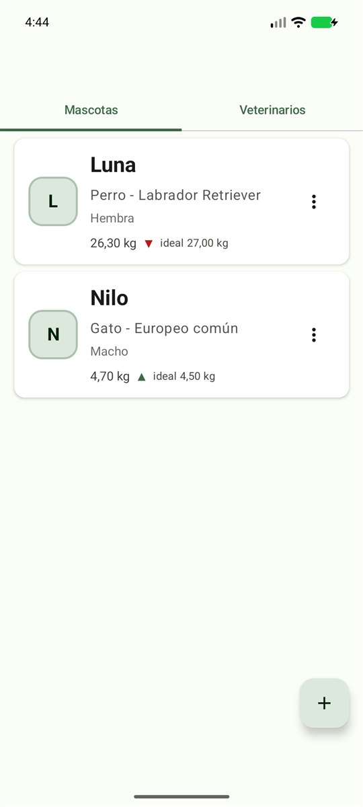 | 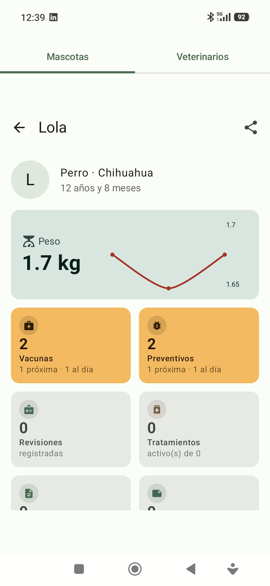 | 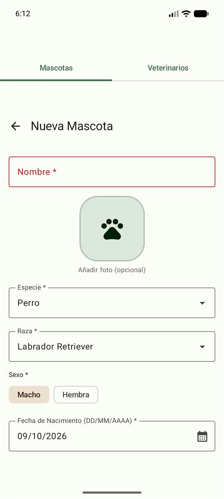 |

### Peso

| Evolución y peso ideal | Histórico |
|------------------------|-----------|
| 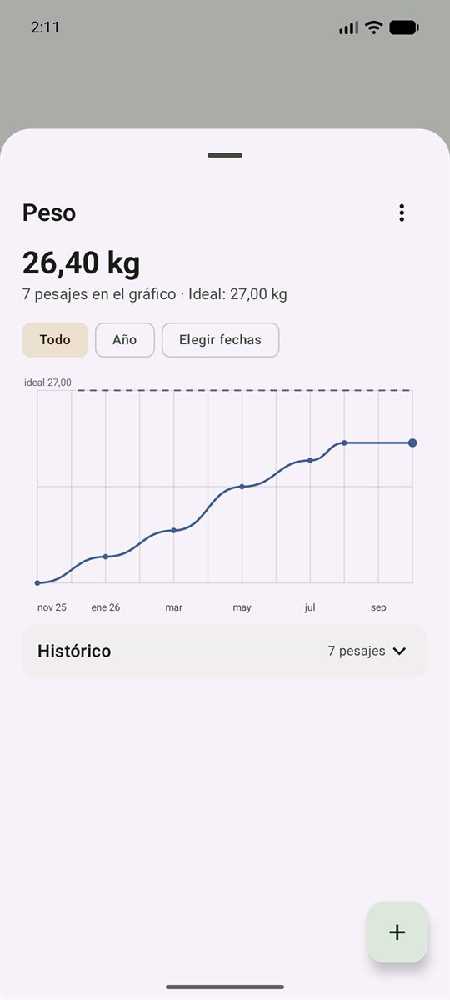 | 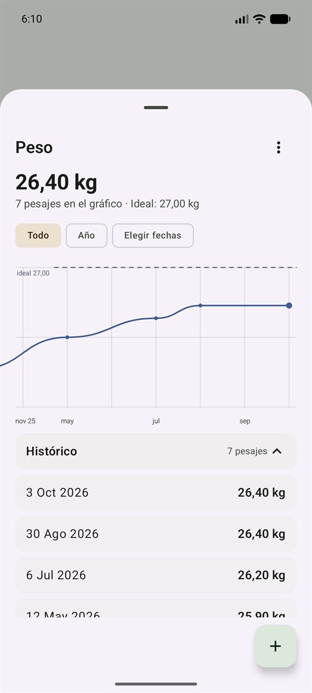 |

### Salud y cuidados

| Vacunas | Preventivos | Visitas y revisiones |
|---------|-------------|----------------------|
| 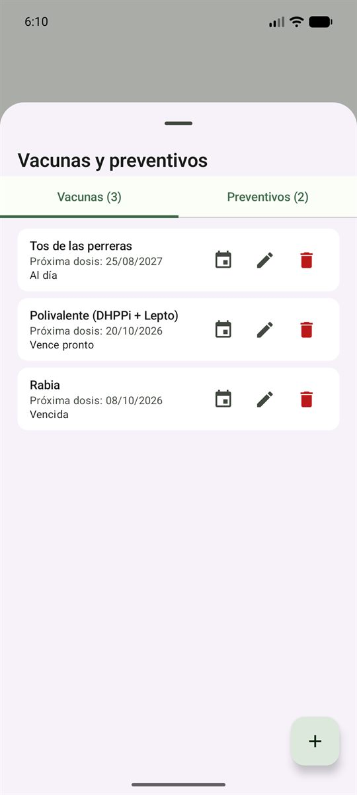 | 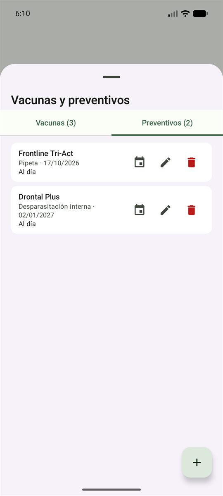 | 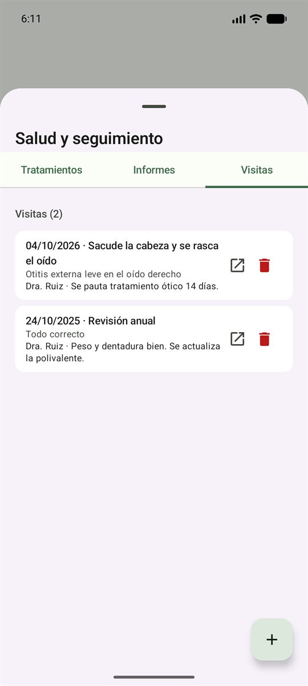 |

### Ficha en PDF

| Exportar (versión y destino) | Compartir con otra app |
|------------------------------|------------------------|
| 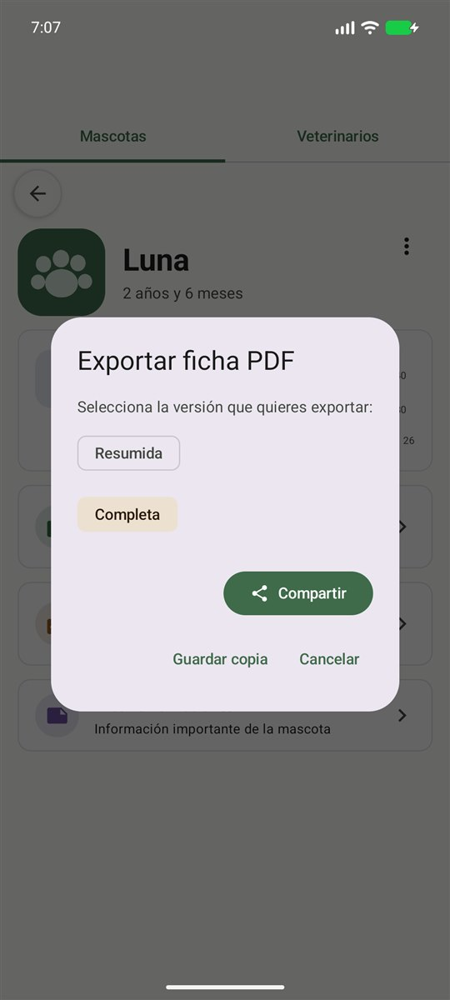 | 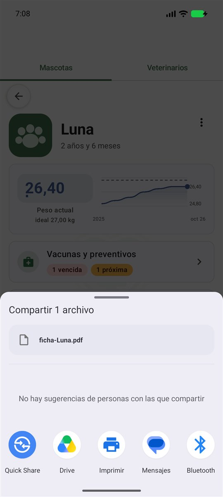 |

### Veterinarios

| Urgencias 24h y agenda |
|------------------------|
| 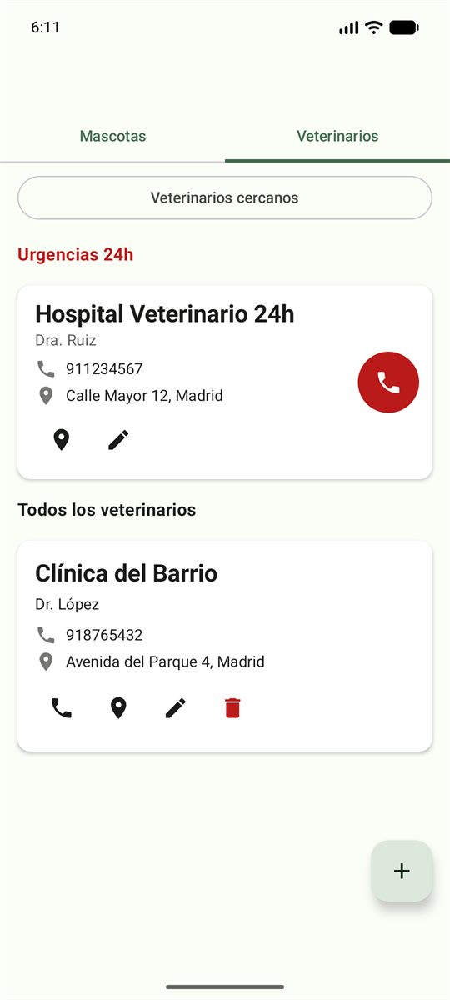 |

---

## 🛠️ Tecnologías

- **Kotlin Multiplatform** — código compartido entre Android y Desktop.
- **Compose Multiplatform** — UI compartida.
- **SQLDelight** — base de datos SQLite multiplataforma con migraciones versionadas.
- **Material 3** — sistema de diseño.
- **kotlinx-datetime** — manejo de fechas multiplataforma.
- **kotlinx-coroutines** — programación asíncrona.
- **AlarmManager + BroadcastReceiver** — notificaciones locales en Android.

---

## 📂 Estructura del proyecto

```
VirtualPetKMP/
├── androidApp/          # Módulo Android (Activity, manifest, recursos)
├── desktopApp/          # Módulo Desktop (main.kt, empaquetado)
├── docs/                # Documentación técnica
├── screenshots/         # Capturas usadas en este README
└── shared/              # Código compartido KMP
    ├── commonMain/      # Código común (UI, lógica, BD)
    ├── androidMain/     # Implementaciones específicas de Android
    ├── jvmMain/         # Implementaciones específicas de JVM/Desktop
    └── sqldelight/      # Esquema y migraciones de la BD
```

---

## 🚀 Cómo ejecutar el proyecto

**Requisitos previos:**
- JDK 11 o superior.
- Android Studio o IntelliJ IDEA con plugin de Kotlin.
- Android SDK (para la parte Android).

**App de Android:**
```bash
./gradlew :androidApp:assembleDebug
```

**App de Escritorio:**
```bash
./gradlew :desktopApp:run
```

Con **hot reload** durante el desarrollo:
```bash
./gradlew :desktopApp:hotRun --auto
```

---

## ✅ Tests

```bash
./gradlew :shared:jvmTest         # Tests de JVM
./gradlew :shared:allTests        # Todos los tests
```

Los tests usan una base de datos SQLite en memoria creada desde el esquema, así que prueban los
repositorios y los cálculos de verdad. **Al arreglar un fallo, añade el test que lo habría
cazado**: es la única red de seguridad de un proyecto sin backend.

---

## 🌍 Idiomas, unidades y fechas

La app está en **español, inglés, portugués, francés, alemán e italiano**, y se adapta sola al
idioma y a la región del dispositivo.

**Dónde están los textos**

```
shared/src/commonMain/composeResources/
├── values/strings.xml      # inglés: idioma por defecto y de respaldo
├── values-es/strings.xml   # español: idioma original de la app
├── values-pt/strings.xml
├── values-fr/strings.xml
├── values-de/strings.xml
└── values-it/strings.xml
```

Todas las claves y su orden son **idénticos** en los seis ficheros; un test lo comprueba
(`ParidadTraduccionesTest`), porque olvidar un texto en un idioma no rompe la compilación: el
sistema cae al inglés y el fallo pasaría desapercibido.

**Las tres reglas de adaptación**

| Qué | Regla |
| --- | --- |
| **Peso** | Se guarda **siempre en kilos**. Se muestra en **libras solo si la región es Estados Unidos** (`en-US`); Reino Unido y el resto, en kilos. La conversión ocurre al mostrar y al leer el campo, nunca en la base de datos. |
| **Fecha** | Orden **mes/día solo en inglés**; el resto, día/mes. Al escribir se acepta el orden de la región y, como respaldo, el otro. |
| **Decimal** | Coma en español y portugués; punto en el resto. |

Los valores que viven en la base de datos (especie, raza, sexo, tipo de preventivo) **se guardan
en español y se traducen solo al mostrarlos** (`TraduccionesDatos`). Traducir lo guardado
rompería las mascotas que ya existen: el formulario compara la raza con la lista de su especie
para rellenar el desplegable.

⚠️ **Traducciones provisionales.** El alemán, francés, portugués e italiano están traducidos sin
revisión de un hablante nativo. Antes de publicar en esos idiomas hay que repasarlos,
especialmente los nombres de raza.

---

## 📚 Documentación

- **[Arquitectura](docs/ARQUITECTURA.md)** — capas, navegación, base de datos y migraciones,
  convenciones, decisiones de interfaz y cómo trabajar con el código específico de plataforma.
  Es el documento que hay que leer antes de tocar el proyecto.

### Capturas para la documentación

Las imágenes de este README se generan a partir de una base de datos de ejemplo, para que
muestren siempre el mismo aspecto (una vacuna vencida, una próxima, un tratamiento activo…):

```bash
# 1. Genera una base de datos con datos de ejemplo
./gradlew :shared:generarDatosEjemplo -PejemploSalida=C:/ruta/datos-ejemplo.db

# 2. Cópiala al dispositivo y abre la app
adb push datos-ejemplo.db /data/local/tmp/datos-ejemplo.db
adb shell "run-as com.example.virtualpetkmp sh -c 'cat /data/local/tmp/datos-ejemplo.db > /data/data/com.example.virtualpetkmp/databases/virtualpet.db'"
```

---

## 📌 Estado del proyecto

🚧 **En desarrollo activo.** Actualmente en fase beta con testers.

### ✅ Implantado

- [x] **Gestión de mascotas** completa: alta, edición, borrado con confirmación y foto (galería o cámara).
- [x] **Ficha como panel**, con cabecera (foto, nombre, edad y menú de acciones) y tarjetas por bloque con un único aviso cada una.
- [x] **Vacunas y preventivos** con próxima dosis, estado (vencida / vence pronto / al día) y recordatorio añadible al calendario.
- [x] **Peso**: gráfico de línea con todo el histórico ajustado al ancho, eje de meses con el año al cambiar, y peso ideal como referencia discontinua. El eje se recalcula solo e incluye el peso ideal, así que la referencia se coloca a su altura exacta y nunca toca un borde.
- [x] **Peso ideal**: opcional, configurable desde la ficha de la mascota o desde la hoja de peso, con indicador ▲/▼ en la lista. Al cambiarlo, el gráfico y los indicadores se actualizan al momento (el estado es reactivo, no hace falta reiniciar).
- [x] **Histórico de peso plegable**, con filtros (6 meses / año / mes actual / rango de fechas) y modal para editar o eliminar un pesaje. El gráfico decide por el filtro si dibujar un punto por mes o uno por pesaje, y se desplaza en horizontal cuando la serie no cabe en la pantalla.
- [x] **Revisiones veterinarias, tratamientos, informes adjuntos y notas**.
- [x] **Agenda de veterinarios** con urgencias 24 h, llamada directa y navegación con Google Maps.
- [x] **Exportar la ficha a PDF** en dos versiones pensadas para lectores distintos:
      la **completa** para el veterinario (identificación, tratamientos en curso **con la dosis**,
      historial, vacunas y preventivos con lote y veterinario, visitas con diagnóstico y notas,
      evolución del peso con primero/último/mínimo/máximo y peso ideal, e informes) y la
      **resumida** para quien cuida a la mascota (qué hay que darle con su dosis, cada cuánto y
      hasta cuándo, las próximas dosis juntas y las notas a tener en cuenta).
- [x] **Compartir el PDF** con el "compartir" del sistema (`ACTION_SEND` de `application/pdf`):
      WhatsApp, correo, Drive... o **guardar una copia** donde elija el usuario. El PDF pasa por
      la caché con un `FileProvider`, así que ninguna otra app necesita permisos de almacenamiento.
- [x] **Notificaciones locales** de próximas dosis, con permiso de alarmas exactas en Android 12+.
- [x] **Tema claro y oscuro**.
- [x] **Multiidioma (es, en, pt, fr, de, it)**, con unidades y formato de fecha según la región:
      peso en libras solo en Estados Unidos (siempre guardado en kilos), orden de fecha
      día/mes salvo en inglés y separador decimal de la región.
- [x] **Arquitectura offline-first** con base de datos local y migraciones versionadas, con
      **tests que migran desde cualquier versión anterior** y comprueban que los datos sobreviven.
- [x] **Los fallos se ven**: si una operación no se puede guardar o borrar, la ficha lo dice con
      el detalle del error en vez de recargar como si hubiera ido bien.
- [x] **Tests** de repositorios, migraciones de esquema, errores de las operaciones, los cálculos
      del resumen de la ficha y la internacionalización (paridad entre idiomas y resolución real
      del idioma en ejecución).

### 🔜 Pendiente antes de la v1.0

- [ ] **Cartilla veterinaria**: poder guardarla y consultarla dentro de la app, con fotos
      (una foto por página, reutilizando el selector de foto actual) o en PDF/imágenes.
      Requiere decidir antes: tabla nueva de páginas de cartilla (`mascotaId`, `ruta`,
      `fecha`, `nota`), su migración, y cómo mostrar un PDF dentro de la app (hoy los PDF se
      abren con una app externa).
- [ ] **Backup y paso de datos entre PC y móvil**: en una primera fase, exportar e importar
      la base de datos completa a un archivo (es un único fichero SQLite, así que es copiarlo;
      con el compartir del sistema ya se puede subir a Drive o enviarlo por correo). La
      sincronización automática entre dispositivos queda para más adelante: necesita backend
      o cuenta de Google y resolver conflictos.
- [ ] Publicación en Google Play Store.

### 🔍 Revisar (no bloquea la v1.0)

- [ ] **Traducciones de alemán, francés, portugués e italiano sin revisión nativa**: están
      hechas con cuidado, pero conviene que las repase un hablante antes de publicar. Los
      nombres de raza son los que más varían de un país a otro
      (`shared/.../util/TraduccionesDatos.kt` y `values-de|fr|it|pt/strings.xml`).
- [ ] **Comprobar el diseño en alemán en un dispositivo real**: es el idioma con textos más
      largos. Las filas de pastillas y de chips ya usan `FlowRow` para saltar de línea, pero
      no se ha podido ver en pantalla porque el emulador de pruebas tiene la región fija en
      inglés (Estados Unidos).
- [ ] **Unificar el menú ⋮ en las tarjetas de veterinario**: hoy conservan sus iconos propios
      (llamada, mapa, editar, borrar) en vez de un único menú, como ya se hizo en las de
      mascota.
- [ ] **Línea de peso ideal en los extremos**: si el peso ideal coincide con el máximo o el
      mínimo de los datos, la referencia queda pegada al borde del gráfico y se ve poco.
      Habría que darle un margen extra en ese caso.
- [ ] **Comprobar el PDF compartido en un móvil sin ninguna app de mensajería**: el caso está
      cubierto con un aviso ("no hay ninguna aplicación para compartir archivos"), pero solo se
      ha probado el camino normal.

---

## 📜 Licencia

**Todos los derechos reservados.** El código fuente de este proyecto es privado y no se permite su uso, copia, modificación ni distribución sin autorización expresa del autor.

Si estás interesado en el código, puedes contactar con el autor.

---

## 👤 Autor

**Enrique Robles** — [@eyemerald](https://github.com/eyemerald)

---

## 📚 Más información

- [Kotlin Multiplatform](https://www.jetbrains.com/help/kotlin-multiplatform-dev/get-started.html)
- [Compose Multiplatform](https://www.jetbrains.com/lp/compose-multiplatform/)
- [SQLDelight](https://sqldelight.github.io/sqldelight/)
